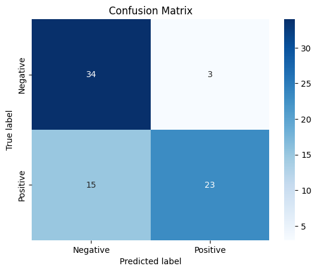

# Movie-review sentiment and feedback triage

I built a bidirectional LSTM to classify short IMDb reviews as positive or negative. A possible use is to send likely complaints to a person for follow-up. On **75 test reviews**, the classifier flagged **49** as negative. That queue contained **34 of the 37 negative reviews** and **15 positive reviews**. A support team can use those counts to judge the extra reading it would take to catch complaints.

*Confusion matrix for 75 test reviews; rows show actual sentiment and columns show predictions.*

[Open the evaluation notebook](notebooks/sentiment_bilstm.ipynb) · [Inspect the trained Keras model](models/imdb_sentiment_bilstm_model.keras) · [View the source reviews](data/imdb_labelled.txt)

## Results

| Actual sentiment | Predicted negative | Predicted positive |
|---|---:|---:|
| Negative | 34 | 3 |
| Positive | 15 | 23 |

Test accuracy was **76.0%**. The 75-review test set is small, so this estimate should be interpreted cautiously and confirmed on a larger independent test set. With *positive* as the target class, precision was 88.46%, recall was 60.53% and F1 was 0.7188. The queue above uses *negative* predictions, so the matrix is the place to read its workload. [Figures from the project report](assets/report-extracts/)

## Text processing and model

I cleaned and tokenized 748 labeled reviews, removed English stopwords and padded sequences to 50 tokens. That length covered 99.3% of the reviews. The model used a 100-dimensional embedding, a 128-unit bidirectional LSTM, a 64-unit dense layer, dropout and early stopping. The stratified split produced 598 training, 75 validation and 75 test reviews.

I fitted the tokenizer on the full review set before splitting it. For a customer-support pilot, fit the vocabulary on training text alone and evaluate on feedback from the intended channel. The IMDb score describes performance on movie reviews.

## Run it yourself

Install the [Python requirements](requirements.txt) in a Jupyter environment and run the notebook with `notebooks/` as its working directory. The notebook requests the NLTK stopwords resource on first use. I use the preprocessing cells to reconstruct the vocabulary and padded inputs before running the saved model. It takes encoded token sequences. [Training split](data/train_dataset.csv) · [Validation split](data/validation_dataset.csv) · [Test split](data/test_dataset.csv)

## Data and environment

Data: IMDb excerpts from UCI Sentiment Labelled Sentences; [attribution](data/README.md).  
Install: `python -m pip install -r requirements.txt`; [environment details](requirements-verified.txt).

*WGU M.S. in Data Analytics coursework, D604 Advanced Analytics.*
